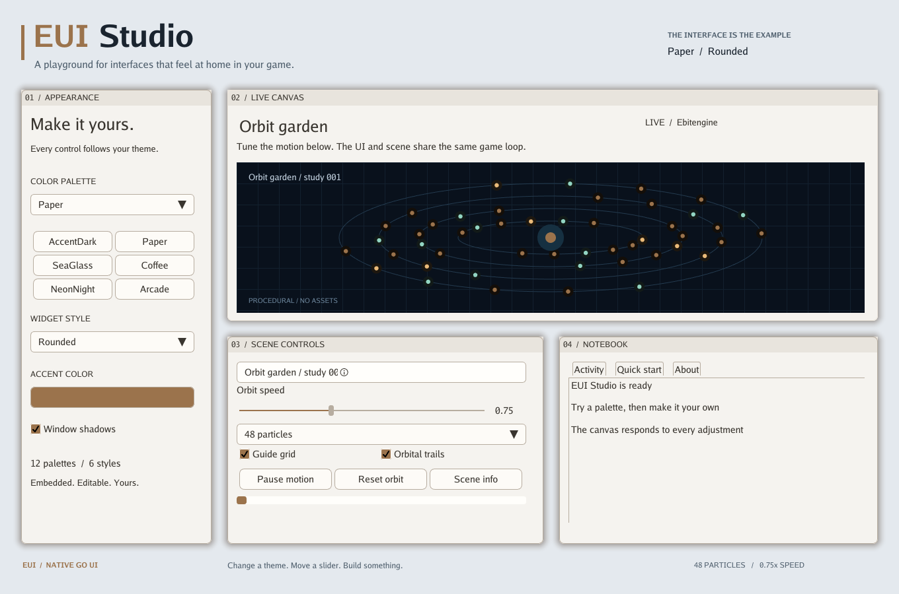

# EUI

**A native Go UI toolkit for Ebitengine. Small setup. Lots of possibilities.**

Build game settings, editors, debug tools, dashboards, and in-game interfaces with
real windows and widgets. Fonts, palettes, and styles are embedded: no asset
bundle, browser, or separate renderer to set up.


*EUI Studio is a real application built with the library. Every control works.
The canvas is drawn procedurally with Ebitengine; the screenshot comes directly
from the running program.*

## Try the studio

Requires **Go 1.26.6** and the usual Ebitengine platform dependencies.
This repository is private; use a GitHub account with access.

```sh
gh repo clone Distortions81/EUI
cd EUI
go run ./examples/studio
```

- Switch among **12 palettes and 6 styles** without restarting.
- Pick a custom accent with the HSV and opacity editor.
- Change particle count, orbit speed, grid, and trails in the live canvas.
- Pause, resume, reset, and rename the scene.
- Open a dialog and select its text; explore the notebook's tabs.

Try a different starting look:

```sh
go run ./examples/studio -theme Paper -style Rounded
```

<details>
<summary>See the light theme</summary>



</details>

The studio uses a 1360 × 900 logical canvas, scaled to fit the desktop window.
For a minimal application that follows the window's dimensions and display
scale, see [`examples/basic`](examples/basic/main.go).

## Add EUI to your game

Configure authenticated Git access for the private repository, then add it to
an existing Go module:

```sh
GOPRIVATE=github.com/Distortions81/EUI go get github.com/Distortions81/EUI
```

Import the package as `eui`:

```go
import eui "github.com/Distortions81/EUI"
```

Initialize once and compose your UI:

```go
if err := eui.Init(); err != nil {
    return err
}
win := eui.NewWindow()
win.Title = "Tools"
win.AutoSize, win.Movable, win.Closable = true, true, true
win.AddItem(eui.NewColumn(
    eui.NewLabel("Ready to build."),
    eui.NewActionButton("Say hello", func() {
        eui.ShowPopup("Hello", "Your UI is running.", []eui.PopupButton{
            {Text: "Great!"},
        })
    }),
))
win.MarkOpen()
```

Connect EUI to your `ebiten.Game`:

```go
func (g *Game) Update() error {
    return eui.Update()
}

func (g *Game) Draw(screen *ebiten.Image) {
    // Draw your game here, then the UI on top.
    eui.Draw(screen)
}

func (g *Game) Layout(w, h int) (int, int) {
    return eui.Layout(w, h)
}
```

That is the entire integration. See the [complete basic program](examples/basic/main.go)
for the `main` function and window setup.

## What is included

| Area | Features |
| --- | --- |
| Layout | Rows, columns, sections, tabs, scrolling, anchoring, automatic sizing |
| Windows | Movement, resizing, snapping, search, shadows, cached rendering |
| Controls | Buttons, checkboxes, radio buttons, sliders, dropdowns, progress bars |
| Text | Inputs, selection, wrapping, URL callbacks, cached scrolling text windows |
| Dialogs | Message/action popups, color pickers, context menus, tooltips |
| Appearance | Embedded fonts, 12 palettes, 6 styles, live accents, display scaling |
| Rendering | Ebitengine images, reusable render targets, repaint coalescing |

Widget constructors return an item and an event handler when you need detailed
control. The convenience builders (`NewColumn`, `NewRow`, `NewLabel`, and
`NewActionButton`) keep common layouts short. Set `Size` for explicit dimensions,
and use `Fixed` / `Scrollable` for bounded viewports.

## Themes included

**Palettes:** AccentDark, AccentLight, Arcade, Candy, Coffee, Dusk, Forest,
HighContrast, Midnight, NeonNight, Paper, SeaGlass.

**Styles:** Borderless, Breeze, Flat, HighContrast, Outline, Rounded.

Example JSON templates are included alongside the built-ins. All original
palettes and styles from goThoom are preserved in [`themes`](themes/README.md).
Colors and widget geometry are independent:

```go
if err := eui.LoadTheme("SeaGlass"); err != nil {
    return err
}
if err := eui.LoadStyle("Rounded"); err != nil {
    return err
}
```

Call `SetUserDataRoot` to choose where editable themes live; it creates example
files there. Enable `AutoReload` while designing a theme. EUI does not change the
process working directory. `Init` loads embedded Go regular/bold fonts while
preserving custom fonts installed earlier with `SetFontSource` and
`SetBoldFontSource`.

## A few useful boundaries

- EUI currently has **one global UI context**. Mutate UI state on the game thread.
- `Close` hides ordinary windows for reuse; `RemoveWindow` retires them. Popup and
  color-picker windows remove themselves on close.
- Popups are floating dialogs; they do not block interaction with other windows.
- `NewTextWindow` supplies a scrolling text view and optional editable display.
  Use `NewInput` for a standalone input control. Application text-window editing,
  URL actions, and annotation policies are supplied by your own callbacks.
- Most dimensions use logical UI units. `eui.Layout` handles display scaling;
  custom framebuffer layouts should set EUI's screen size and scale explicitly.

## Develop and verify

On Debian/Ubuntu, install the native build and headless test dependencies:

```sh
sudo apt-get install build-essential pkg-config libgl1-mesa-dev xorg-dev xvfb
```

With a desktop display:

```sh
go test ./...
go vet ./...
go build ./...
```

On headless Linux, prefix test or example commands with `xvfb-run -a`.
GitHub Actions runs the same tests, vet, and build checks.

Regenerate the README images from the real application:

```sh
xvfb-run -a go run ./examples/studio -screenshot docs/studio.png
xvfb-run -a go run ./examples/studio -theme Paper -style Rounded -screenshot docs/studio-light.png
```

The screenshot option writes one frame and exits. No image editor is needed.
More focused theme visual checks are documented in [`themes/README.md`](themes/README.md).

## Origin and license

EUI was extracted from [goThoom](https://github.com/Distortions81/goThoom), where it
was developed for a real desktop game client. This repository is independent;
goThoom continues using its own local EUI copy.

[MIT licensed](LICENSE). No Clan Lord game assets are included.
