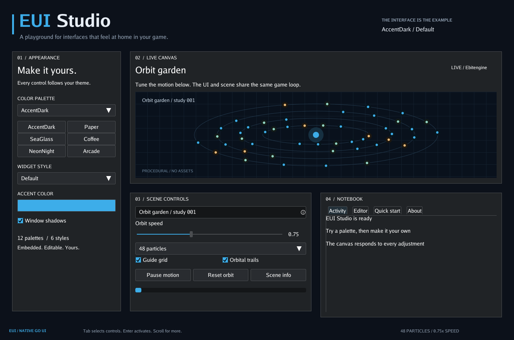

# EUI

A native Go UI toolkit for Ebitengine. Build game interfaces, editors, settings
panels, and desktop tools with embedded fonts, palettes, and styles.



## Install

Requires **Go 1.27.1 or newer** and targets **Ebitengine 2.10.2**.
Desktop builds support `CGO_ENABLED=0` and require the usual display and graphics
runtime libraries; see [development setup](docs/development.md).

```sh
go get github.com/M45-Software/EUI
```

## Try Studio

```sh
git clone https://github.com/M45-Software/EUI.git
cd EUI
go run ./examples/studio
```

Explore live themes, responsive layouts, text editing, forms, modal dialogs,
and gamepad navigation. See the [Studio guide](docs/studio.md) for options
and more screenshots.

## Features

- Rows, columns, tabs, scrolling, and resizable windows.
- Buttons, inputs, sliders, dropdowns, color pickers, and validated forms.
- Text editing with undo/redo, highlighting, word wrapping, and IME composition.
- Keyboard, pointer, touch, and optional gamepad navigation.
- Independent UI contexts, 12 palettes, and 6 styles.

## Documentation

- [API reference](docs/api/README.md) — integration, contexts, layout, controls, input, events, and themes.
- [Basic application](examples/basic/main.go) — a complete starting point.
- [Ownership and embedding](docs/client-integration.md).
- [Development and verification](docs/development.md).
- [Performance measurements](docs/performance.md).
- [Theme files](themes/README.md).

## Origin and license

Extracted from [goThoom](https://github.com/M45-Software/goThoom).
[MIT licensed](LICENSE). No Clan Lord game assets are included.
