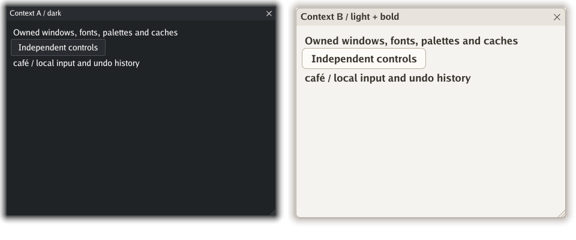
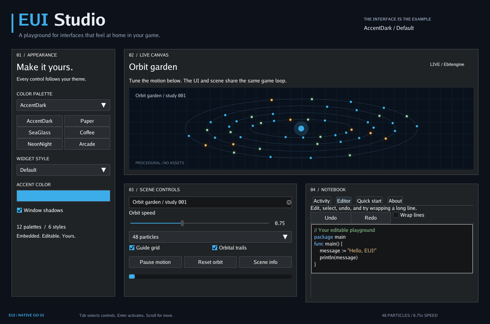

# EUI API

[Project overview](../../README.md) · [Basic example](../../examples/basic/main.go)

Detailed integration and behavior reference for EUI.

- [Add EUI to your game](#add-eui-to-your-game)
- [Independent UI instances](#independent-ui-instances)
- [Responsive layout](#responsive-layout)
- [Gamepad navigation](#gamepad-navigation)
- [Forms and validation](#forms-and-validation)
- [Testing interactions and replay](#testing-interactions-and-replay)
- [Event delivery](#event-delivery)
- [Editing text](#editing-text)
- [IME composition](#ime-composition)
- [Modal dialogs](#modal-dialogs)
- [Keyboard navigation](#keyboard-navigation)
- [Updating controls](#updating-controls)
- [Themes included](#themes-included)
- [A few useful boundaries](#a-few-useful-boundaries)

## Add EUI to your game
Import the package as `eui`:

```go
import eui "github.com/M45-Software/EUI"
```

Initialize once and compose your UI:

```go
ui, err := eui.NewContext()
if err != nil { return err }
defer ui.Dispose()
win := ui.NewWindow()
win.Title = "Tools"
win.AutoSize, win.Movable, win.Closable = true, true, true
win.AddItem(ui.NewColumn(
    ui.NewLabel("Ready to build."),
    ui.NewActionButton("Say hello", func() {
        ui.ShowPopup("Hello", "Your UI is running.", []eui.PopupButton{
            {Text: "Great!"},
        })
    }),
))
win.MarkOpen()
```

Store `ui` on your game, then connect it to `ebiten.Game`:

```go
type Game struct { UI *eui.Context }

func (g *Game) Update() error {
    return g.UI.Update()
}

func (g *Game) Draw(screen *ebiten.Image) {
    // Draw your game here, then the UI on top.
    g.UI.Draw(screen)
}

func (g *Game) Layout(w, h int) (int, int) {
    return g.UI.Layout(w, h)
}
```

That is the entire integration. See the [complete basic program](../../examples/basic/main.go)
for the `main` function and window setup.

## Independent UI instances

Create a `Context` with `eui.NewContext()`. Constructors, input, focus, scale,
fonts, palettes/styles, file-watch paths, menus, callbacks and renderer caches
belong to that instance. There is no selected or default instance. A callback
may update another context without changing the caller's state.

```go
hud, err := eui.NewContext()
if err != nil { return err }
defer hud.Dispose()
settings, err := eui.NewContext()
if err != nil { return err }
defer settings.Dispose()
settings.LoadTheme("Paper")
settings.SetInputEnabled(false) // draw it while routing native input to HUD
```

Use instance constructors such as `ui.NewWindow()` and `ui.NewInput()`. For
custom controls use `ui.NewItem(eui.ItemData{ItemType: eui.ITEM_FLOW})`, or attach
unowned configuration to an owned parent before using context-dependent methods.
A control retains its context after detaching. Mixing controls, windows or owned
handlers from different contexts panics before a tree is changed. Types, enums,
color literals and pure helpers remain in the package.

Route input with `ui.SetInputEnabled` or each instance's `ui.SetInputSource`.
Disabled instances keep focus and values, update animations, and draw. Native
Ebitengine devices and its one OS text-input session are physical shared
resources: enable native input on one instance at a time. Custom sources can
route separate coordinate spaces and input streams to multiple instances.
System clipboard access is also shared by the OS; `ui.SetClipboard` can provide
an isolated adapter. These resource boundaries do not share UI state.

`Dispose()` closes owned event queues, cancels preedit, releases cached images
and pools, and retires all live owned handles, including detached controls.
It is idempotent, emits no application callbacks, and keeps application-owned
images intact. Calls during Update/Draw defer resource release until that call
finishes. A disposed `Update()` returns `eui.ErrContextDisposed`; `Draw()` does
nothing. Other context operations and context-dependent handle methods panic
after disposal. Do not copy a context or use its zero value; use NewContext.
Calls on the same context belong on the game goroutine. Recursive Update on that
same context returns `eui.ErrContextReentry`; independent contexts may be called
from callbacks. See [ownership and embedding](../client-integration.md).



## Responsive layout

`Size` is a preferred logical size. Layout keeps it intact; `GetSize()` reports
the resolved pixel footprint. Zero dimensions use measured content. Natural
flows and captions can grow for content; `Fixed` / `ConstrainToSize` keep a
specified box, and `MinSize` / `MaxSize` constrain the final footprint, including
field labels. Zero limits mean unbounded; a conflicting minimum takes precedence.

| Setting | Behavior |
| --- | --- |
| `MinSize`, `MaxSize` | Logical lower and upper limits on each dimension |
| `FillWidth`, `FillHeight` | Consume available space within those limits |
| `Gap` | Logical space between visible flow children, with no trailing gap |
| `ContentPadding` | Logical `Insets{Left, Top, Right, Bottom}` inside a flow |
| `MainAlign` | Pack the child group at `LayoutStart`, `LayoutCenter`, or `LayoutEnd` along the flow |
| `CrossAlign` | Align individual children across the flow with the same constants |

In a row, width-filling children share the space left after non-filling children,
gaps, and padding. Columns share height in the same way. Capped shares are
redistributed, and minima are preserved even if the viewport is too small. Across
the flow, fill consumes its usable width or height; centered/end alignment still
applies if a maximum prevents filling it. Overlays fill each child independently.
Position adds an inset and participates in measurement. Hidden children contribute
neither size nor gap. Scrolling areas reserve scrollbar space, and tab content
starts below the measured tab strip.

```go
left := ui.NewColumn(ui.NewLabel("Navigation"))
left.Size.X = 180
left.MaxSize.X = 220
right := ui.NewColumn(ui.NewWrappedLabel("Content follows the viewport.", 400))
right.FillWidth = true
right.Contents[0].FillWidth = true
row := ui.NewRow(left, right)
row.FillWidth = true
row.Gap = 16
row.ContentPadding = eui.Insets{Left: 12, Top: 12, Right: 12, Bottom: 12}
win.AddItem(row)
```

For a scrolling body between fixed rows, use a fixed/filling column and give its
body `FillHeight`, `Fixed`, and `Scrollable`. `LayoutWindowBody` also handles this
pattern and reserves flow gaps and padding. Wrapped labels reflow at their
allocated width, so following rows move with their changed height.

Use `SetSize`, `SetSizeLimits`, `SetFill`, `SetFlowLayout`, and
`SetContentPadding` for runtime changes with automatic reflow. Direct field edits
followed by `win.Refresh()` can batch a structural layout update. Choose row or
column arrangements at application-specific breakpoints, as Studio does, rather
than shrinking every control. `ScrollIntoView()` reveals a control without
changing its focus, caret, or selection.

## Gamepad navigation

Call `ui.SetGamepadNavigation(true)` to opt in. Native input uses controllers
with Ebitengine standard-layout mappings. Replay sources supply one `GamepadInput`
per connected controller in `InputFrame.Gamepads`; omitted IDs disconnect. Buttons
are all held standard buttons, and `LeftX`/`LeftY` are stick axes. Non-finite axes
reject the entire frame; finite values clamp to [-1, 1]. Duplicate IDs use their
first entry and invalid IDs/buttons are ignored. Input slices are copied into
state during the one frame sample and are never retained.

| Control | Behavior |
| --- | --- |
| D-pad / left stick | Move focus spatially within the active window; reveal offscreen controls |
| Bottom face button | Activate buttons, checkboxes and radios; open/select dropdowns; enter/finish adjustment |
| Right face button | Back: composition, menu/dropdown, search, adjustment, then modal Cancel/close |
| Shoulder buttons | Previous/next focus stop, with wrapping |
| Menu button | Next window; trapped inside a modal |

Sliders, color wheels and tab strips require Confirm to enter adjustment mode.
Directions then use their normal keyboard adjustments; Confirm or Back finishes.
This lets spatial navigation leave a slider without changing its value. Radios
change only on Confirm. On an editable field, directions move focus without
editing text; Confirm invokes its window's default action. Gamepads do not
provide text entry or an on-screen keyboard. While IME preedit is active only
Back can cancel it; other navigation waits for fresh neutral input.

The first controller with navigation intent acquires ownership, with the lowest
ID winning simultaneous intent. It remains owner until disconnected or routing
is reset. A controller first seen held must return to neutral before acting.
Stick engagement is 0.45 with a 0.30 release threshold; the dominant axis wins,
horizontal breaks exact ties, D-pad overrides the stick, and opposed D-pad
buttons cancel. Direction repeat begins on tick 25, then every 6 Update ticks.
Confirm, Back, shoulder and menu actions never repeat while held.

Modal transitions and controller/input handoffs suppress held inputs until
neutral. `SetInputEnabled(false)` and `SetKeyboardInputCaptured(true)` also
suspend gamepad navigation. Physical keyboard/pointer actions have precedence
over simultaneous pad input. Configuration, disconnect, and routing handoffs
cancel adjustment capture without synthesizing a slider release. Ordinary
direction release emits the normal changed slider release event.

`ActiveGamepad` returns the owner; `GamepadInputHandled` lets the host reserve
claimed navigation input. Route shared native devices to one enabled context.
`GamepadCancelHandler` receives Back when no EUI layer consumes it.
`NavigationPrompts()` returns host-renderable action/label pairs for the most
recently used device, including adjustment mode. Gamepad labels describe physical
positions without assuming a controller brand. Studio enables navigation and
changes its footer hints as devices are used.

## Forms and validation

Form fields keep drafts separate from applied values. Built-in `Required`,
`NumberRange` and `IntegerRange` validators can be combined with custom
`TextValidator` functions. Number bounds are inclusive; numeric rules allow empty
text unless combined with `Required`. Numeric whitespace is accepted without
changing the stored string. Validators must be pure and run on the UI goroutine.

```go
name := ui.NewFormField("name", "Name", "Garden", eui.Required)
count := ui.NewFormField("count", "Particles", "48",
    eui.Required, eui.IntegerRange(1, 200))
form := ui.NewForm(name, count)
win.AddItem(form.View())

apply := ui.NewActionButton("Apply", func() {
    if err := form.Apply(); err != nil { return }
    values := form.Values() // a copy; update your model here
    _ = values
    win.Close()
})
cancel := ui.NewActionButton("Cancel", win.Close)
win.DefaultButton, win.CancelButton = apply, cancel
win.OnClose = form.Cancel
win.AddItem(ui.NewRow(cancel, apply))
win.MarkOpenModal()
```

`Apply` validates every field before replacing the applied snapshot. Failure
leaves applied values unchanged, reveals inline errors, and focuses the first
available invalid field. `FormValidationError.Fields` contains errors by name.
An unfinished IME composition prevents Apply and retains editing focus. Errors
update on committed typing, paste, undo/redo, `ReplaceText`, and `UpdateText` after
validation has first been requested. `Validate` reveals errors without applying.
Disabled/hidden fields still validate; write optional rules for conditional data.

`Cancel` silently restores the last applied values and discards preedit,
undo/redo, and error messages. `Values`, `Draft`, `Errors`, and `Fields` return
copies; `Dirty` includes pending composition. Values include logical password
text. Keep the field's default private `TextPtr` to preserve draft isolation.
Use `Input()` to configure a field and `ErrorLabel()` to style its wrapped error
label. Direct `Text` assignments require explicit validation. Studio's **Forms**
tab demonstrates a complete scene settings dialog.

## Testing interactions and replay

`SetInputSource` accepts a function returning one `InputFrame` per `Update`.
Native Ebitengine input uses the same transition tracking as replayed frames.
Supply all held keys/buttons/contacts, plus only the text and wheel deltas for
that tick. Coordinates are screen pixels; keep the frame clock nonzero and
nondecreasing. Zero/backward times or non-finite wheel deltas return an error
from `Update` before changing UI state. Invalid key/button codes and duplicate
contact IDs are ignored. The slices are consumed without being retained or
modified.

```go
frame := eui.InputFrame{Time: time.Unix(1, 0), PointerX: 100, PointerY: 80}
previous := ui.SetInputSource(func() eui.InputFrame { return frame })
defer ui.SetInputSource(previous)

// Press, then release on the next game tick.
frame.MouseButtons = []ebiten.MouseButton{ebiten.MouseButton0}
if err := ui.Update(); err != nil { return err }
frame.Time = frame.Time.Add(time.Second / 60)
frame.MouseButtons = nil
if err := ui.Update(); err != nil { return err }
```

Held-key repeats count `Update` ticks. Clock advancement controls double clicks,
caret blinking, click flashes, repaint scheduling, and browser wheel throttling;
it does not synthesize skipped repeat ticks. `Draw` uses the last replayed time
without polling the source again. Native rendering still uses wall time, as do
profiling, display-scale polling, and file-watch checks. Set `Mac` on a replay
frame to exercise Command/Option shortcuts on another host platform.

A sole touch is the primary pointer. Two or more contacts end primary capture
and scroll with the two lowest IDs. Switching scroll contacts resets the gesture
baseline, and returning to a remaining single contact does not synthesize a new
click. Replacing a primary contact completes its old capture before a fresh
contact can press. `PointerPosition` reads current native device positions or the
latest custom-source sample. UI handlers use the single frame latched by Update,
so host pointer queries do not repoll the UI's source.

Change sources between updates on the UI goroutine. `SetInputSource(nil)` restores
the devices. Switching sources cancels gestures and menus and resets clock/held
input history, preserving focus, selection, values, and text history. Preview
callbacks can run when menus are dismissed, as with other preview cancellation.

`SetClipboard` accepts a `Clipboard` implementation with `ReadText` and
`WriteText` methods. It returns the previous implementation; nil uses the system
clipboard. This lets replay tests exercise copy, failed cut/paste, and undo/redo
without reading or changing the host clipboard.

The normal suite drives complete sequences through `Update` and `Draw`, covering
mouse/touch capture, key repeat, window gestures, dividers, search, radio groups,
tab pages, dropdown previews, reentrant callbacks, text editing, platform
modifiers, and timing. Run it with a display available (Xvfb on Linux):

```sh
CGO_ENABLED=0 xvfb-run -a go test -tags 'integration test' ./...
EUI_INTERACTION_CAPTURE=/tmp/replay.png CGO_ENABLED=0 xvfb-run -a \
  go test -run '^TestRenderInteractionReplay$' .
```

The workflow is configured for Linux pixel regressions and Windows/macOS tests,
vet, build, and a native Studio editor smoke render. Local test results and platform validation limits are recorded in
[the follow-up plan](../followup-plan.md).

## Event delivery

Callbacks are the default. Widget constructors return a handler with no queue;
assign `Handle` for detailed events, or use `NewActionButton` for a click action.
Callbacks run synchronously on the EUI/game goroutine. Keep them short and apply
UI changes on that goroutine.

```go
slider, events := ui.NewSlider()
events.Handle = func(event eui.UIEvent) {
    if event.Type == eui.EventSliderChanged {
        volume = event.Value
    }
}
```

Each interaction updates widget state first, queues a value snapshot if enabled,
calls `Handle`, then calls the control's convenience callback:

| Interaction | Event | Convenience callback after `Handle` |
| --- | --- | --- |
| Button activation | `EventClick` | `Action` |
| Checkbox toggle | `EventCheckboxChanged` | `Action` |
| Radio activation | `EventRadioSelected` | `Action` |
| Changed slider value | `EventSliderChanged` | `Action` |
| End of a changed slider interaction | `EventSliderReleased` | None |
| Dropdown or context-menu choice | `EventDropdownSelected` | `OnSelect(index)` |
| Changed wheel color | `EventColorChanged` | `OnColorChange(color)`, then `Action` |
| Text edit, undo, or redo | `EventInputChanged` | None |

Pointer and keyboard input use this same order. Radio peers are updated before
notification without separate events. Sliders and color wheels emit change
events only when their value changes. Dropdown previews end before selection
notification; opening, previewing, or canceling a menu does not emit a selection.
A nil `OnColorChange` applies the color to the accent. Programmatic setters are
silent, as described under Updating controls.

Callbacks and payloads are captured for each emitted event. Replacing a callback
inside `Handle` affects the next interaction; changing a control does not rewrite
the current event's payload. `UIEvent.Item` is a live handle, so use the payload
fields when retaining an event. Password input events contain masked text.
Recursive interactions run immediately: the nested callbacks complete before the
outer callback returns, while each handler's queue retains emit order. A callback may remove its
control, close its window, or open a follow-up menu.

To consume events later, explicitly enable a bounded queue:

```go
pending := events.EnableQueue(64)
// During your game Update, drain without blocking:
drainEvents:
for {
    select {
    case event, ok := <-pending:
        if !ok {
            break drainEvents
        }
        consume(event)
    default:
        break drainEvents
    }
}
// Check events.DroppedEvents() to detect overflow and resynchronize if needed.
// Call events.DisableQueue() when finished.
```

Queue delivery is FIFO and nonblocking. A full queue drops the newest event and
increments `DroppedEvents()`; `Handle` and convenience callbacks still run.
Choose capacity for the expected burst and drain regularly. `EnableQueue` requires
a positive capacity, closes any previous channel, and resets the dropped count.
`DisableQueue` closes the channel and retains the count. Closed channels can still
be drained; use the receive `ok` result or range over them rather than receiving
forever. `Events()` returns the current receive-only channel, or nil when disabled.
EUI owns channel closure. Configure queues, emit, and read counters on the game
goroutine; a worker may receive payload snapshots but must not access `Item` or
other UI state there. Queue and callback delivery are both enabled when requested;
using both to perform the same side effect will perform it twice.

## Editing text

Use `NewInput` for a single line, or `NewTextArea` for a scrolling document:

```go
editor, events := ui.NewTextArea()
editor.Size = eui.Point{X: 480, Y: 260}
editor.Text = "First line\nSecond line"
editor.AcceptTab = true
editor.SetWordWrap(true)
events.Handle = func(event eui.UIEvent) {
    if event.Type == eui.EventInputChanged {
        draft = event.Text
    }
}
win.AddItem(editor)
```

Both support selection replacement, word/line navigation, held-key repeat,
grapheme-aware deletion, and bounded undo/redo history. Use Ctrl+A/X/C/V/Z on
Windows and Linux, or Command on macOS. Password fields do not copy, cut, or
retain undo history. Multiline controls scroll the caret into view; optional
word wrapping changes the display without modifying the source text.

`ReplaceText` applies a transformation as one undoable edit. `Undo`, `Redo`,
`CanUndo`, and `CanRedo` support toolbar actions. `FindText` selects and reveals
a literal match. `SetTextHighlighter` accepts rune-indexed `TextColorSpan` ranges;
`CurrentSyntaxColors` supplies the active palette's editor colors. Call
`RefreshTextHighlighting` when your highlighter's external inputs change.
`SetTextColorSwatches` adds clickable color previews over source ranges.

For application-owned chat history and completion, set `ExternalTextEditing`.
Use `FocusedTextInput` to reserve editing keys from game shortcuts.
Application-owned editors manage their own composition and persistence.
See Studio's **Editor** tab for a complete example:

```sh
go run ./examples/studio -tab Editor
```



## IME composition

Internally edited inputs, text areas, passwords, and titlebar search use
Ebitengine's native text-input composer. Preedit is underlined inline, with a
composition selection and caret; it remains separate from `Text`, bindings,
change events, and undo history. A commit replaces the original selection as one
undoable edit and emits one change notification. Password preedit is masked,
existing secrets are omitted from native surrounding-text context, and passwords
retain no undo history. Search callbacks receive committed queries only.

IME-owned keys are processed before shortcuts, navigation, and default buttons.
An Enter that confirms composition does not also submit the form. Ordinary text
is delivered once through the composer. Host shortcuts should continue to respect
`FocusedTextInput()` and `SearchActive()`.

`IsComposing()` reports inline preedit; `CancelComposition()` discards it.
Focus loss, host keyboard capture, hiding/disabling/removing the control, source
replacement, or external changes to its document, selection, wrapping, or geometry
cancel preedit while preserving committed text. The next native session uses the
new caret position. Ebitengine's current public composer API fixes candidate
bounds at session creation, so moving/resizing/scaling or scrolling the control
restarts composition rather than leaving the candidate window at an old position.
`TextInputBounds()` computes the visible caret anchor in logical screen pixels,
including nested layout, labels, wrapping, and scrolling.

For custom sources, supply ordered `InputFrame.TextInput` notifications using
`TextInputCompose`, `TextInputCommit`, `TextInputCancel`, or `TextInputEnd`.
Composition selection and replacement offsets count runes. `TextReplacement`
provides an explicit document range and caret for reconversion; `Target` rejects
notifications intended for a different focused control. Notifications take
precedence over `InputFrame.Text`; active preedit suppresses ordinary keys.
`Passthrough` permits the triggering key after a notification. `TextInputEnd`
stops editing after any preceding commit; `Unfocused` suspends keyboard input and
cancels preedit while retaining control focus for the host's return.

```go
frame.TextInput = []eui.TextInputEvent{{
    Kind: eui.TextInputCompose, Text: "にほん", SelectionEnd: 3,
}}
// On a later tick, replace preedit with the chosen text:
frame.TextInput = []eui.TextInputEvent{{Kind: eui.TextInputCommit, Text: "日本"}}
```

Native behavior follows the platform backend: some IMEs draw their own preedit
and report only commits. Install a font covering the entered language with
`SetFontSource`; the bundled Go fonts do not provide full CJK coverage. Linux X11
preedit/commit/cancel/focus transfer have been verified through an isolated IBus
test engine. Windows and macOS adapters compile and have CI coverage, but real
language-IME sessions on those systems still need validation.

## Modal dialogs

`ui.ShowModal` opens a temporary dialog that blocks pointer, touch, wheel,
keyboard, and window-cycle input to other windows in the same context. Other
contexts keep their own routing. `ui.ModalWindow()` exposes the active modal so
the host can reserve game shortcuts and world input as well.

```go
ui.ShowModal("Discard changes?", "The current draft has unsaved edits.", []eui.PopupButton{
    {Text: "Keep editing", Cancel: true},
    {Text: "Discard", Default: true, Action: discardDraft},
})
```

For a custom dialog, build an ordinary window and call `win.MarkOpenModal()`.
The top modal owns Tab/Shift+Tab and F6 navigation. OnOpen can choose focus;
otherwise the first available control is focused. Popup dialogs focus their
explicit default button when there is no editable/custom control ahead of it.
Enter activates the focused button or the window's DefaultButton. IME-owned
Enter remains a composition commit. Escape first belongs to IME, menus,
dropdowns and search; then it activates CancelButton, or closes a Closable
modal. The close icon uses a configured cancel action too. A disabled cancel
action is not bypassed. BeforeClose can veto closing.

Modals nest. Closing/removing one restores the previous available window,
control, editor selection and search editing without replacing text or undo
history. A hidden/disabled/detached return target is not revived. Removing a
parent before its child carries the parent's return path forward. Reopening an
existing parent does not raise it above its nested child. OnClose can open a
replacement dialog; the replacement keeps input ownership.

Input must return to neutral after a change of modal scope. This prevents the
opening Enter or a held closing press from reaching another dialog or the
exposed background. Captures and preedit are cancelled without synthetic
activation/release events. Background model updates and repainting continue.
`ui.ModalBackdrop` controls dimming; zero alpha disables the visual backdrop.
`ShowPopup` remains a separate nonmodal convenience. Color pickers opened from a
modal join its stack. Popup button actions run before Close; use a custom window
when application validation needs its own submission policy.

## Keyboard navigation

Tab and Shift+Tab move through enabled, visible controls in layout order.
F6 and Shift+F6 cycle through interactive windows in registration order.
Keyboard focus has a contrasting outline and scrolls into view, including in
nested scrolling panels. Hidden controls, disabled subtrees, and inactive tab
pages are excluded.

| Control | Keys |
| --- | --- |
| Button or checkbox | Enter or Space activates/toggles |
| Radio group | One Tab stop; arrow keys move and select within the group |
| Slider | Arrows adjust; Shift takes larger steps; Ctrl/Command takes finer floating-point steps; Page Up/Down, Home/End reach farther or the limits |
| Dropdown or context menu | Up/Down, Home/End navigate; Enter/Space confirms; Escape cancels; Tab dismisses |
| Tab strip | Arrows or Home/End select an enabled page; Tab enters its controls |
| Color wheel | Left/Right change hue; Up/Down saturation; Page Up/Down brightness; Shift takes larger steps |

Editors retain their text-navigation and indentation shortcuts. Single-line
Enter can activate the window's default button. Multiline Enter inserts a newline.

`Focus(item)` focuses and reveals a control; `FocusedItem()` reports general
control focus, while `FocusedTextInput()` reports text editing only.
`SetKeyboardInputCaptured(true)` reserves keyboard handling for the host while
pointer controls remain available. Slider keyboard adjustments emit
`EventSliderChanged` as the value changes and one `EventSliderReleased` when the
adjustment keys are released or focus moves away.

## Updating controls

Runtime setters update the model and invalidate the affected window. Layout
changes reflow automatically; value-only updates use the window's repaint cadence.
Layout changes, focus-sensitive updates, and enabling/disabling repaint without
waiting for a background refresh interval. Direct fields remain convenient during
initial construction; use the setters after attaching controls to a live UI.
For properties without a setter, assign the field and call `win.Refresh()`;
that invalidates layout and item render caches as well as the window cache.

| Setter | Behavior |
| --- | --- |
| `SetValue`, `SetRange` | Slider/progress values are clamped to finite, ordered bounds; integer sliders stay on an in-range integer |
| `SetChecked` | Updates a checkbox/radio; checking a grouped radio unchecks peers in its container/window |
| `SetDisabled` | Disables a subtree while preserving each child's own disabled flag and layout |
| `SetVisible` | Hides/shows a subtree, removing/restoring its layout space |
| `SetOptions` | Copies option strings, normalizes selection, resets menu scrolling, and dismisses an active preview |
| `SetSelected` | Selects a dropdown row; `-1` clears selection; header and invalid indices are ignored |
| `SetActiveTab` | Selects an enabled, visible page and reflows its contents |
| `UpdateText` | Updates labels or input values; input bindings are synchronized, offsets clamped, and undo history reset |
| `SetWrappedText` | Preserves source paragraphs while rewrapping a label |
| `SetLabel`, `SetSize`, `SetTooltip` | Update field labels, logical dimensions, and help indicators with layout invalidation |
| `SetWheelColor`, `SetColorSwatch`, `SetButtonColors` | Repaint color controls without triggering their user callbacks |

```go
speed.SetRange(0, 2)
speed.SetValue(1.25)
enabled.SetChecked(true)
choices.SetOptions([]string{"Low", "Medium", "High"})
choices.SetSelected(1)
advanced.SetVisible(showAdvanced)
settings.SetDisabled(busy)
```

Programmatic setters do **not** emit `UIEvent`, `Action`, `OnSelect`, or
`OnColorChange`. This lets a user-event handler synchronize related controls
without feeding changes back into itself. Dismissing an open dropdown preview
may call `OnHover` once with the previous selection to restore its appearance.
An unchanged scalar value does not schedule a repaint. `SetOptions` still owns a copy
of an identical input slice. Option images retain their row indices; shortening
options truncates excess image references without disposing application images.

`ReplaceText`, `Undo`, and `Redo` are editing commands: they retain their
`EventInputChanged` behavior. Use `UpdateText` to replace a model value silently,
including in a disabled input. Password updates take the logical secret and
keep the displayed text masked. `SetWordWrap` changes presentation while retaining
the draft, selection, and history. For flows, `Fixed`, `Scrollable`, and
`ConstrainToSize` continue to govern how an explicit `SetSize` is resolved.

Hiding or disabling controls cancels their focus, selection, and drag state and
closes their menus. It does not resume those interactions when shown or enabled.
Changing page availability selects another available page, or leaves `ActiveTab`
at `-1` when none exists. Hidden progress bars do not keep a window repainting.
Dirty item render caches are discarded on the next paint; application-owned
`Image` values are retained. Child updates (`AddItem`, `RemoveItem`, `InsertItem`,
`ReplaceItem`, and batched `SetItems`) also reflow a live window automatically.
Row/column builders attach their children in one batch.

`BeforeClose` may return false to keep a window open while resolving unsaved
changes. Closing clears its input state and releases cached render targets,
including tab contents. `RemoveWindow` retires it; detached items release their
cached targets and can be attached again. Window lifecycle callbacks keep their
existing behavior.

## Themes included

**Palettes:** AccentDark, AccentLight, Arcade, Candy, Coffee, Dusk, Forest,
HighContrast, Midnight, NeonNight, Paper, SeaGlass.

**Styles:** Borderless, Default, Flat, HighContrast, Outline, Rounded.

Example JSON templates are included alongside the built-ins. All original
palettes and styles from goThoom are preserved in [`themes`](../../themes/README.md).
Colors and widget geometry are independent:

```go
if err := ui.LoadTheme("SeaGlass"); err != nil {
    return err
}
if err := ui.LoadStyle("Rounded"); err != nil {
    return err
}
```

Call `SetUserDataRoot` to choose where editable themes live; it creates example
files there. Enable `AutoReload` while designing a theme. EUI does not change the
process working directory. `NewContext` loads embedded Go regular/bold fonts. Choose custom fonts on that
instance with `ui.SetFontSource` and `ui.SetBoldFontSource`.

## A few useful boundaries

- Each `Context` owns its UI state. Use it on the Ebitengine/game goroutine and dispose it when finished.
- `Close` hides ordinary windows for reuse; `RemoveWindow` retires them. Popup and
  color-picker windows remove themselves on close.
- `ShowPopup` opens a floating dialog; `ShowModal` blocks other windows in its context.
- `NewTextWindow` supplies a scrolling text view and optional editable display.
  Use `NewInput` for a standalone input control. Application text-window editing,
  URL actions, and annotation policies are supplied by your own callbacks.
- Most dimensions use logical UI units. `ui.Layout` handles display scaling;
  custom framebuffer layouts should set EUI's screen size and scale explicitly.
