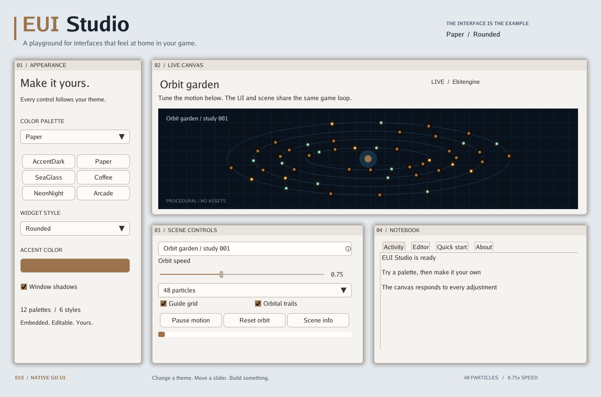
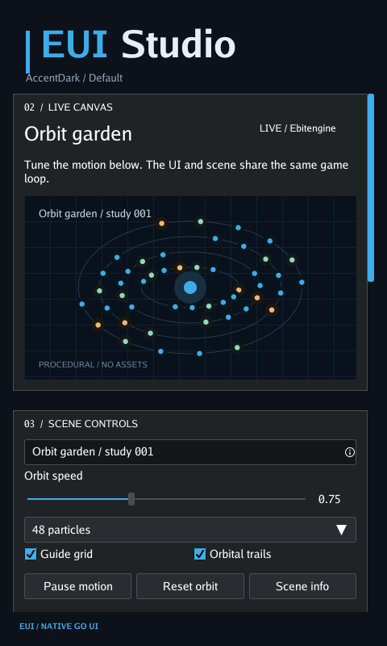

# EUI Studio

[Project overview](../README.md) · [API reference](api/README.md)


Requires **Go 1.27.4**. EUI targets **Ebitengine 2.10.6**; desktop builds support
`CGO_ENABLED=0` and need the usual display/graphics runtime libraries.

```sh
gh repo clone M45-Software/EUI
cd EUI
go run ./examples/studio
```

- Switch among **12 palettes and 6 styles** without restarting.
- Pick a custom accent with the HSV and opacity editor.
- Change particle count, orbit speed, grid, and trails in the live canvas.
- Pause, resume, reset, and rename the scene.
- Open a dialog and select its text; explore the notebook's tabs.
- Edit highlighted Go text in the **Editor** tab, undo/redo, and toggle word wrapping.

Try a different starting look:

```sh
go run ./examples/studio -theme Paper -style Rounded
```

<details>
<summary>See the light theme</summary>



</details>

Studio follows the window dimensions. At desktop widths it uses a dashboard;
medium windows stack the scene and notebook beside appearance controls; narrow
windows use one scrolling column. Controls, editor drafts, history, and selection
survive breakpoint changes. The supported minimum window is 360 × 480.

```sh
go run ./examples/studio -width 480 -height 800
```

<details>
<summary>See the narrow layout</summary>



</details>

For a minimal application that follows the window dimensions and display scale,
see [`examples/basic`](../examples/basic/main.go).
